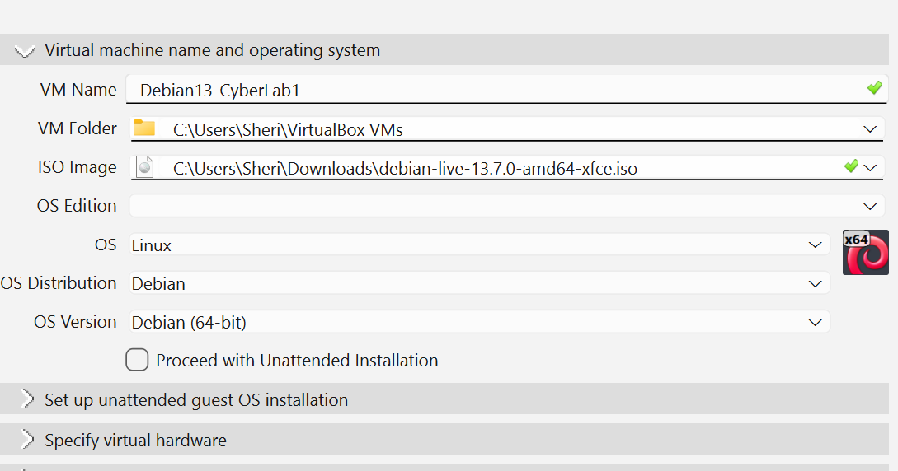
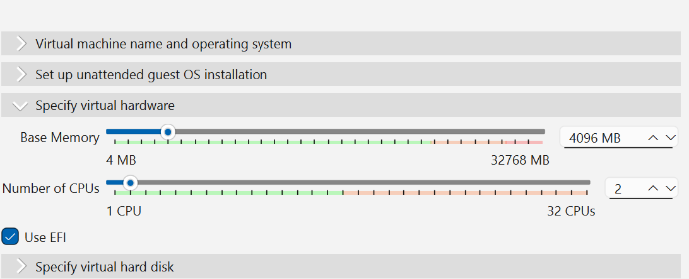
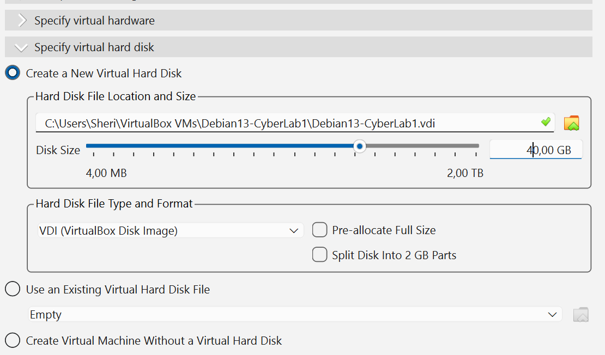
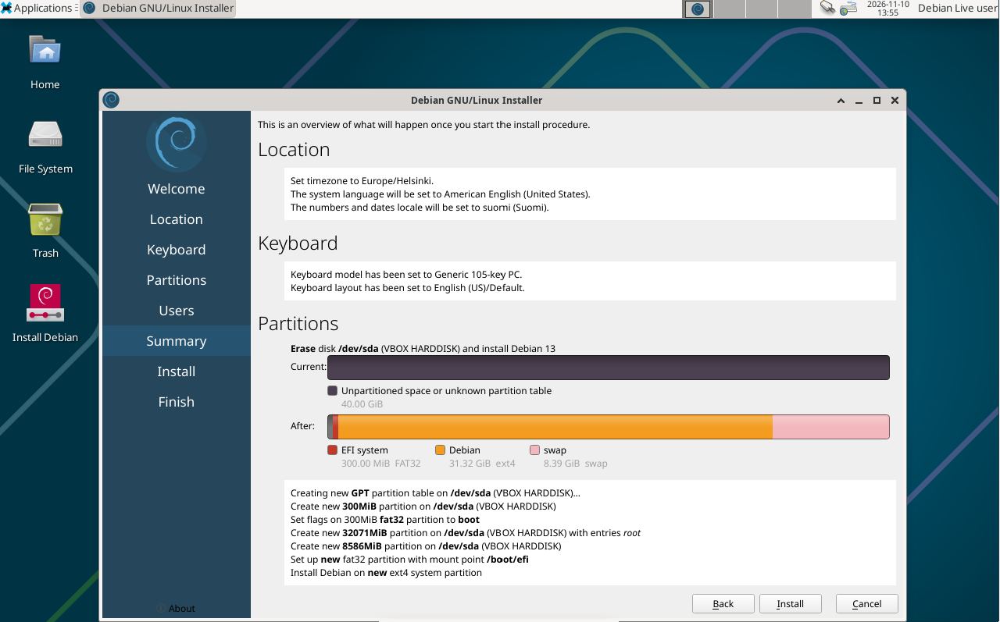
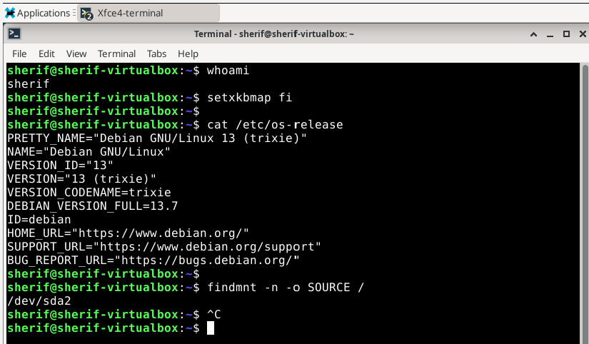
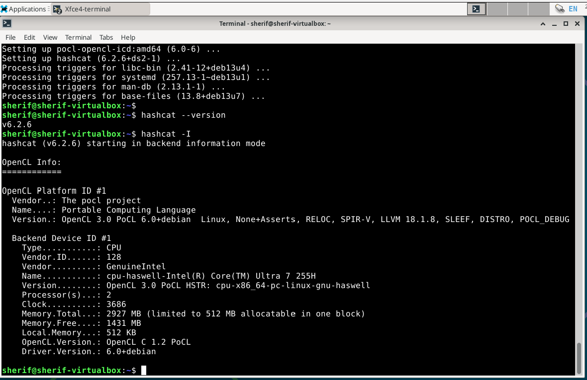

# H3 – Cyber Lab: Debian 13 and Hashcat

**Course:** Cyber Security – ICB705AS3YE-3002  
**Work date:** 10 November 2026  
**Host:** Windows 11, Oracle VirtualBox  
**Guest:** Debian GNU/Linux 13.7 (Trixie)

**Progress:** Debian 13 was installed and verified. Hashcat was installed and its OpenCL CPU backend was detected. The assigned password hash was **not** cracked during the documented session. My presentation slot appears in the course agenda, but the title reservation in Laksu has **not been confirmed**.

## X. Reading notes

I read the three assigned articles. ChatGPT helped me turn their main points into concise English notes, while the practical observations refer to the Debian and Hashcat work documented below. This wording is AI-assisted, as disclosed in the references section.

### Heinonen (2026) – How to Install Linux to VirtualBox?

- The article explains how to create a Debian 13 virtual machine on Windows using VirtualBox: selecting the ISO, Debian 64-bit, RAM and CPU settings, virtual disk, and manual installation.
- It recommends testing the Live system first, then checking the installer settings, especially the keyboard, user account and disk selection.
- **My observation:** I already knew the general idea of virtual machines, but the actual installation showed how much host settings and keyboard layouts can affect the result. In my lab, Debian eventually worked, although the `vmwgfx` boot warnings returned later.

### Karvinen (2020) – Command Line Basics Revisited

- The article covers useful Linux commands for moving around directories, viewing and editing files, getting help, and managing packages with `sudo` and `apt-get`.
- It also explains the command prompt, tab completion, command history and Linux paths. Small details in command syntax matter.
- **My observation:** During the lab I typed `/y` instead of `-y` and misspelled `hashcat` once. I also had trouble with the Finnish and US keyboard layouts. These are simple mistakes, but they showed why reading the exact error output is important.

### Karvinen (2022) – Cracking Passwords with Hashcat

- The article explains that a password hash is not decrypted directly. Instead, Hashcat tests password guesses from a dictionary and compares the results with the target hash.
- It shows how to use `hashid` to identify possible hash types, select the correct Hashcat mode (MD5 is mode `0` in the example), and interpret the results. Testing must be done only with authorized hashes.
- **My observation:** I installed Hashcat 6.2.6 and confirmed that its OpenCL CPU backend was available in Debian. However, I did not complete the dictionary attack. Verifying a tool installation is not the same as completing the security experiment.

## A. Presentation title reservation

**Presentation Title:** From 5G-Advanced to 6G: Cybersecurity Challenges for Enterprise Networks

**Presentation Date:** 2 December 2026 (Week 49)

**Course Theme:** New Developments

**Reservation:** Completed in Laksu.

**Topic Overview:**

The presentation will focus on current cybersecurity challenges in 5G and 5G-Advanced (5.5G), including network slicing, cloud-native networks, edge computing, and AI-driven network automation.

It will also discuss how these security challenges may evolve towards 6G, particularly for enterprise connectivity services and mobile network operators.

The presentation will connect current technologies and practical industry examples with future security requirements.


## B. Debian 13 installation on a virtual machine

### Configuration and setup

I used Debian 13.7.0 Live Xfce (`amd64`) with Oracle VirtualBox. The screenshots below show configuration and the first installation attempt in `Debian13-CyberLab1`. After troubleshooting, the successful working and verification screenshots were captured in `Debian13-CyberLab3`.

The VM configuration used Debian (64-bit), **2 virtual CPUs**, **4,096 MB RAM**, a **40 GB virtual disk**, EFI, and manual installation (unattended installation disabled).

**Figure 1 — Original VM and Debian ISO configuration.** [View image at full size](h3-01-vm-configuration.png)



**Figure 2 — Virtual hardware resources.** [View image at full size](h3-02-vm-resources.png)



**Figure 3 — Virtual disk creation.** [View image at full size](h3-03-vm-disk.png)



The installer partition summary selected **VBOX HARDDISK (`/dev/sda`)**, a 40 GiB virtual disk. The screenshot was taken *before* confirming that installation step; it is evidence of the proposed partition layout, not evidence of completion by itself.

**Figure 4 — Installer summary from the original attempt.** [View image at full size](h3-06-installer-summary.png)



Additional screenshots: [Live boot menu](h3-04-debian-boot-menu.png), [Debian Live desktop](h3-05-debian-live-desktop.png), and [working CyberLab3 desktop](h3-07-cyberlab3-desktop.png).

### Verification of the installed Debian system

I ran the following commands in `Debian13-CyberLab3` and observed the results shown below. The root filesystem `/dev/sda2` indicates that the running session used an installed filesystem rather than the temporary Live overlay.

```bash
whoami
# sherif

cat /etc/os-release
# PRETTY_NAME="Debian GNU/Linux 13 (trixie)"
# VERSION_ID="13"
# DEBIAN_VERSION_FULL=13.7

findmnt -n -o SOURCE /
# /dev/sda2
```

**Figure 5 — Terminal verification of Debian version and root filesystem.** [View image at full size](h3-08-debian-terminal-verification.png)



### Problems and attempted solutions

The installation and first boot involved repeated troubleshooting. Some boots displayed `vmwgfx` warnings and did not advance to the visible desktop. I checked VirtualBox display and system settings and Windows virtualization settings. Debian reached the Xfce desktop during a later session, but the warning recurred on subsequent starts. **The intermittent boot issue remained unresolved.**

My Finnish and US keyboard layouts caused confusion with special characters and password entry; I tested `setxkbmap fi` during the session. I also initially typed `/y` instead of `-y` and `hashchat` instead of `hashcat` while installing packages, then corrected those errors. Pasting an entire earlier terminal transcript produced a *Potentially Unsafe Paste* warning and `command not found` errors, so long command transfer remained an issue.

Evidence: [APT typing errors](h3-09-apt-troubleshooting.png), [clipboard warning](h3-11-clipboard-warning.png), and [the recurring vmwgfx warning](h3-12-boot-warning.png).

## C. Hashcat experiment

I installed Hashcat, Hashid and Wget using the Debian package manager. `hashcat --version` reported **v6.2.6**, and `hashcat -I` showed a **PoCL OpenCL CPU backend** with **2 virtual processors**.

```bash
sudo apt-get update
sudo apt-get install -y hashcat hashid wget
hashcat --version
# v6.2.6

hashcat -I
# OpenCL CPU device available through PoCL
# Processors: 2
```

**Figure 6 — Hashcat installation verification and CPU device.** [View image at full size](h3-10-hashcat-opencl.png)



**Hash assigned in the exercise:** `6b1628b016dff46e6fa35684be6acc96`.

**Result:** I installed Hashcat and verified the CPU backend, but I **did not run and document a successful dictionary attack against the assigned hash**. Therefore, I do not claim to have cracked the password. This part is only partially complete.

### Practical observation

The successful Debian terminal session and Hashcat device detection showed that the virtual machine was usable for basic Linux and security-tool exercises. The main unresolved obstacle was unreliable reboot behavior, followed by difficulties copying long commands from Windows into the guest.

## References and AI use

- Heinonen, J. (2026). [How to Install Linux to VirtualBox?](https://github.com/johannaheinonen/johanna-test-repo/blob/main/module_1.md)
- Karvinen, T. (2020). [Command Line Basics Revisited](https://terokarvinen.com/2020/command-line-basics-revisited/)
- Karvinen, T. (2022). [Cracking Passwords with Hashcat](https://terokarvinen.com/2022/cracking-passwords-with-hashcat/)
- Karvinen, T. (2026). [Cyber Security – H3 Cyber lab instructions](https://terokarvinen.com/cyber-security/)
- **AI assistance:** ChatGPT (OpenAI), 10 November 2026. Used for troubleshooting VirtualBox, Linux commands and clipboard errors, explaining technical output, drafting the Part X reading summaries from the cited articles and discussion, and organizing / editing this report. Example requests included help diagnosing recurring `vmwgfx` warnings, installing Hashcat and organizing authentic screenshots. All claimed experimental results are based on my lab screenshots; no completed hash cracking is claimed.
