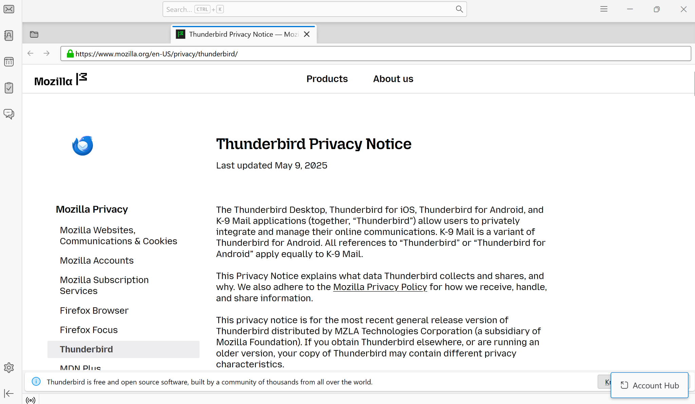
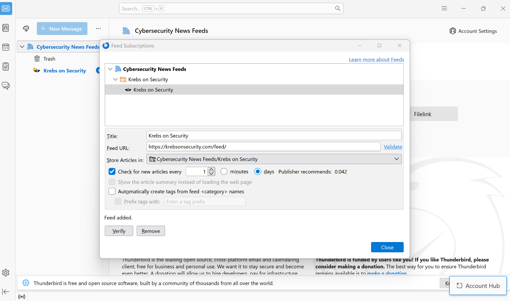
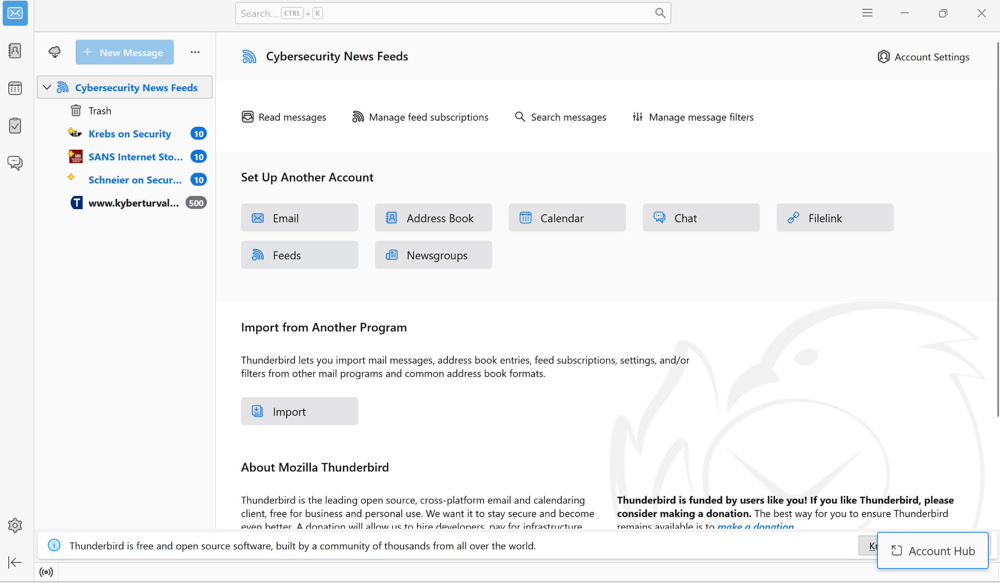
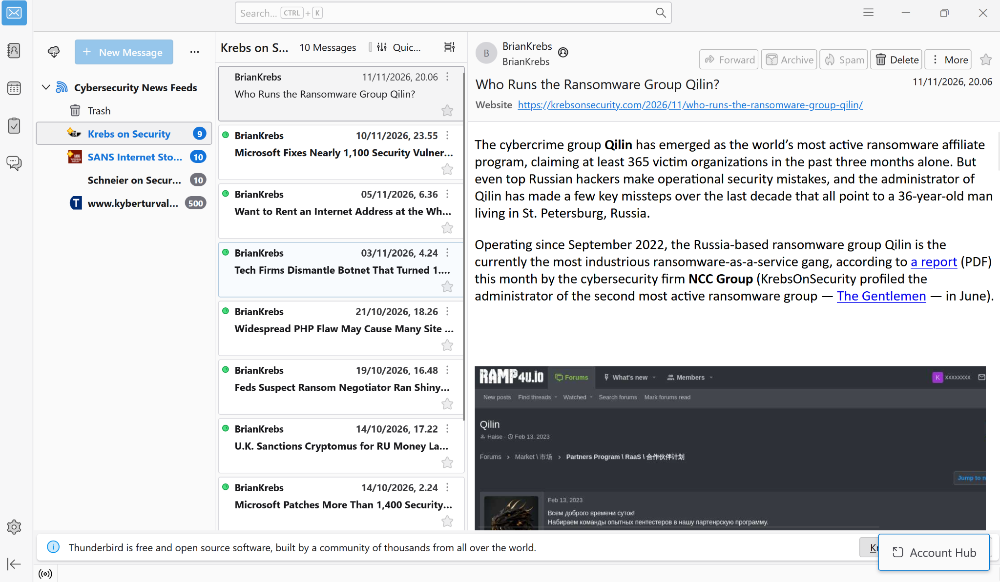
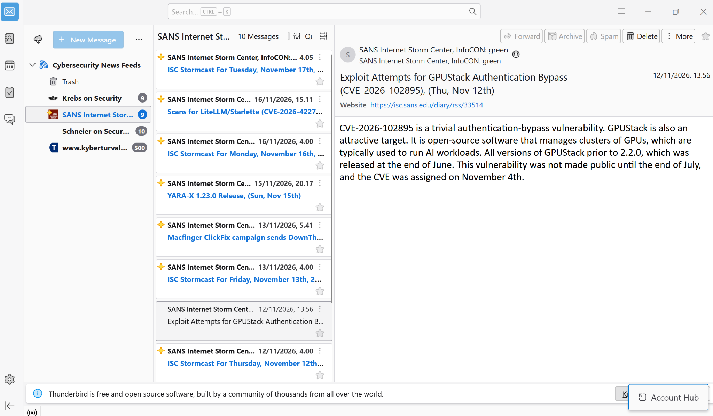

# H4 Feed Me

Cyber Security ICB705AS3YE 3002 | Haaga-Helia University of Applied Sciences

Sherif Hassan | 17 November 2026

This report covers RSS and Atom news feeds, a Finnish port-scanning court case, practical feed-reader subscriptions, a short reading exercise, and a localhost Nmap comparison performed in Debian.

## x Why use a feed reader and RSS or Atom

- RSS and Atom deliver updates automatically from websites that publish feeds.

- A reader gathers articles from several sources in one place, so I do not need to visit every website separately.

- It makes new posts easier to notice and allows me to organize different cybersecurity sources.

- The disadvantage is the number of posts. Some feeds also include only summaries, so I still open the original article for complete details.

My view: RSS is useful for routine security monitoring, while browsing the original websites remains important when I want to investigate a story or verify details.

## y Finnish Supreme Court case KKO 2003 36

- The case involved port scanning against the Osuuspankkikeskus banking network in 1998 to search for open proxy services. The scan did not get through the firewall.

- The Supreme Court upheld the finding of attempted unauthorized access in the circumstances of the case. The intent to enter a protected system without permission was significant.

My lesson: a port scanner has legitimate uses in authorized security testing, but scanning someone else's systems without permission can have legal consequences. I therefore limited my practical test to localhost.

Court decision: <https://www.finlex.fi/fi/oikeuskaytanto/korkein-oikeus/ennakkopaatokset/2003/36>

## a Installing a feed reader

I installed Mozilla Thunderbird on Windows and created a dedicated feed account named Cybersecurity News Feeds. Thunderbird can receive RSS and Atom entries in folders and display articles in its reading pane.

*Figure 1. Thunderbird running on Windows during the initial setup. The privacy information page was open.*



## b Krebs on Security feed

I subscribed to the Krebs on Security feed in Thunderbird and confirmed that new posts appeared in the feed folder.

RSS URL: <https://krebsonsecurity.com/feed/>

*Figure 2. Thunderbird feed subscriptions window showing the Krebs RSS URL and the message Feed added.*



## c Schneier on Security feed

I found the Schneier on Security blog and subscribed to its Atom feed. The subscription appeared in the Thunderbird folder list alongside Krebs.

Blog: <https://www.schneier.com/>

Atom URL: <https://www.schneier.com/feed/atom/>

## d Two additional security feeds

I chose two additional sources that complement the more investigative and analytical blogs. I looked for RSS or feed options on the publishers' websites and checked that Thunderbird displayed their entries.

- SANS Internet Storm Center: short, technical reports about current attack activity, vulnerabilities, scanning, and practical security observations. I chose it to follow operational threats.

SANS feed: <https://isc.sans.edu/rssfeed.xml>

- National Cyber Security Centre Finland (Traficom): national warnings and cybersecurity information relevant to Finland. I chose it to complement international articles with a Finnish perspective.

Traficom feed: <https://www.kyberturvallisuuskeskus.fi/feed/rss/fi>

*Figure 3. Thunderbird showing the four subscriptions: Krebs, SANS, Schneier and the Finnish Cyber Security Centre.*



## e Reading the feeds and reflection

I followed the newly added feeds during my initial reading session on 17 November 2026. Two articles stood out because they described different sides of cybersecurity: organized crime and a technical weakness in AI infrastructure.

### Article 1 Who Runs the Ransomware Group Qilin

Brian Krebs | 11 November 2026

Article: <https://krebsonsecurity.com/2026/11/who-runs-the-ransomware-group-qilin/>

- The Qilin ransomware-as-a-service group claimed hundreds of victims and used affiliates to carry out intrusions.

- Affiliates were reportedly offered at least 80 percent of extortion payments. The attacks used double extortion: stealing data as well as encrypting systems.

- Investigators linked older usernames, Telegram accounts, forum information and leaked records to connect different criminal identities.

- Operational security mistakes made over several years can make supposedly anonymous attackers easier to investigate.

What I learned: ransomware groups operate like organized businesses, and threat intelligence often depends on connecting small pieces of evidence over time.

*Figure 4. Reading the Qilin article from Krebs on Security inside Thunderbird.*



### Article 2 GPUStack authentication bypass

Johannes Ullrich, SANS Internet Storm Center | 12 November 2026

Article: <https://isc.sans.edu/diary/rss/33514>

- GPUStack is open-source software for managing GPU clusters used for AI workloads.

- The article described CVE-2026-102895, an authentication bypass affecting GPUStack versions before 2.2.0.

- A request could falsely identify its source as the local loopback address through the X-Gpustack-Real-IP header and bypass a trust check.

- SANS observed requests attempting to exploit the weakness. The case illustrates why an untrusted request header should not be used as proof of authorization.

What I learned: even AI infrastructure can be exposed by basic trust and authentication mistakes. I should consider both conventional security controls and emerging AI systems when monitoring threats.

*Figure 5. Reading the SANS GPUStack authentication bypass article inside Thunderbird.*



### Benefits and downsides of following feeds

- Benefit: I can see updates from multiple publishers in one place and identify technical news quickly.

- Benefit: reading both an investigative blog and a technical diary gives a broader picture of the security scene.

- Downside: some sources publish many entries, which can create information overload.

- Downside: headlines and short feed previews do not replace reading the source or checking the evidence.

This is an initial observation from one reading session, not a claim of having monitored the feeds for several weeks.

## f Port scanning with Nmap

### Lab environment and installation

I originally installed Debian for use in Oracle VirtualBox, but repeated Windows and virtual machine startup problems prevented me from using that setup for this exercise. I therefore installed Debian locally using Windows Subsystem for Linux (WSL). WSL is a local Linux environment managed by Windows, not an online virtual machine. I used Debian GNU/Linux 13.5 (Trixie).

Windows PowerShell commands and observed results:

```text
PS> wsl --status
Windows Subsystem for Linux is not installed.
PS> wsl --install -d Debian
Installing Windows optional component: VirtualMachinePlatform
The operation completed successfully.
Changes will not be effective until the system is rebooted.
PS> Get-WindowsOptionalFeature -Online -FeatureName VirtualMachinePlatform
State : Enabled
PS> wsl --install -d Debian
Downloading: Debian GNU/Linux
Installing: Debian GNU/Linux
Distribution successfully installed.
```

In the Debian terminal, I confirmed the distribution and updated the package list:

```text
$ cat /etc/os-release
PRETTY_NAME="Debian GNU/Linux 13 (trixie)"
DEBIAN_VERSION_FULL=13.5
$ sudo apt update
Fetched 17.5 MB in 3s
$ sudo apt install -y nmap apache2 iputils-ping
nmap is already the newest version (7.95+dfsg-3).
apache2 is already the newest version (2.4.71-1~deb13u1).
iputils-ping is already the newest version (3:20240905-3).
```

The installation initially started Apache automatically. I stopped it before measuring the baseline so the two scans could be compared.

```text
$ sudo service apache2 stop
$ sudo service apache2 status
Active: inactive (dead)
```

### Checking external connectivity

Before the localhost scans, I checked external connectivity from Debian using a ping request.

```text
$ ping -c 4 8.8.8.8
4 packets transmitted, 0 received, 100% packet loss, time 3079ms
```

No ping replies were received. This alone does not prove the computer was offline, because ICMP replies can be filtered. The scanning target throughout the exercise was localhost (127.0.0.1) only; no external host was scanned.

### First scan with Apache stopped

```text
$ sudo nmap -A -v localhost
Starting Nmap 7.95 at 2026-11-17 14:13 EET
Scanning localhost (127.0.0.1) [1000 ports]
Nmap scan report for localhost (127.0.0.1)
Host is up (0.000045s latency).
All 1000 scanned ports on localhost are in ignored states.
Not shown: 1000 closed tcp ports (reset)
Nmap done: 1 IP address (1 host up) scanned in 1.67 seconds
```

Observation: Nmap did not find an open TCP port among the 1,000 commonly scanned ports before Apache was started.

### Second scan with Apache running

```text
$ sudo service apache2 start
$ sudo nmap -A -v localhost
Starting Nmap 7.95 at 2026-11-17 14:15 EET
Discovered open port 80/tcp on 127.0.0.1
Nmap scan report for localhost (127.0.0.1)
Not shown: 999 closed tcp ports (reset)
PORT   STATE SERVICE VERSION
80/tcp open  http    Apache httpd 2.4.71 ((Debian))
|_http-server-header: Apache/2.4.71 (Debian)
|_http-title: Apache2 Debian Default Page: It works
Nmap done: 1 IP address (1 host up) scanned in 17.56 seconds
```

Observation: after Apache started, port 80/TCP was open and Nmap detected the HTTP service and the Apache version. The other 999 scanned TCP ports remained closed.

### Comparison and security reflection

| **Measure**       | **Apache stopped** | **Apache running**  |
|-------------------|--------------------|---------------------|
| TCP ports scanned | 1,000              | 1,000               |
| Open TCP ports    | 0                  | 1                   |
| Closed TCP ports  | 1,000              | 999                 |
| Port 80           | Closed             | Open, HTTP          |
| Apache identified | No                 | Yes, version 2.4.71 |

I learned that a scan can reveal which services a machine exposes and sometimes identify the software version. This information could guide an attacker toward a particular service. An open port alone is not proof of a vulnerability, however. The test also shows why I should disable services I do not need and only scan machines that I own or am authorized to test.

Limitation: this comparison covered Nmap's 1,000 default TCP ports on localhost; it was not a scan of every possible port or any external system. The verbose Nmap output also included OS fingerprints that were not required for interpreting the result.

## Sources

Finnish Supreme Court KKO 2003 36: <https://www.finlex.fi/fi/oikeuskaytanto/korkein-oikeus/ennakkopaatokset/2003/36>

Krebs on Security: <https://krebsonsecurity.com/2026/11/who-runs-the-ransomware-group-qilin/>

SANS Internet Storm Center: <https://isc.sans.edu/diary/rss/33514>
