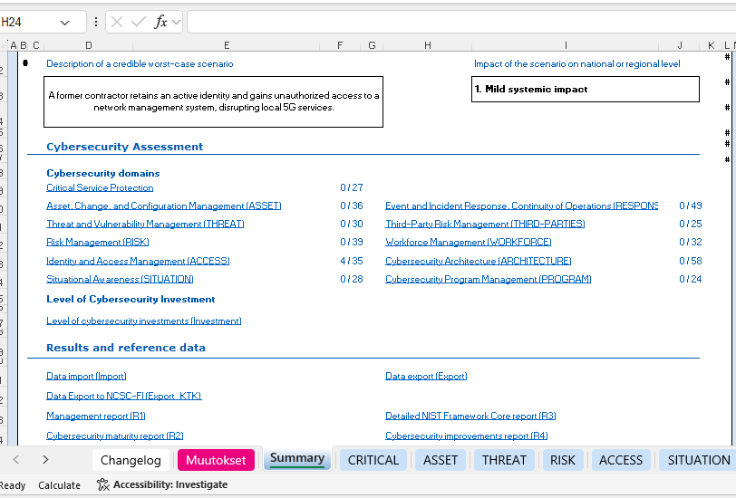
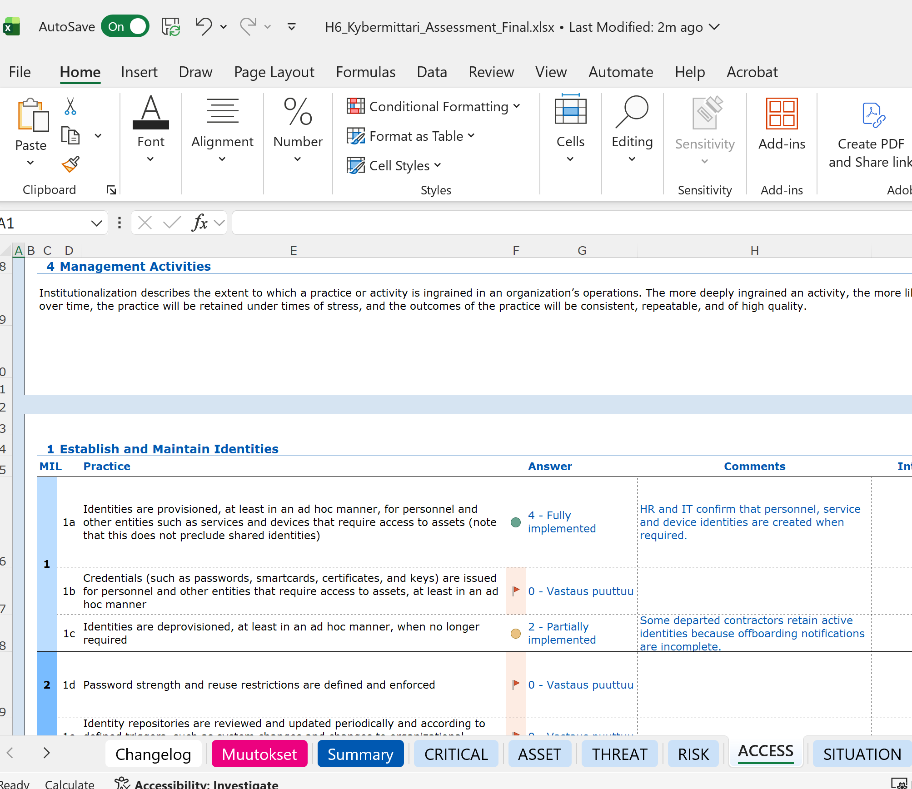
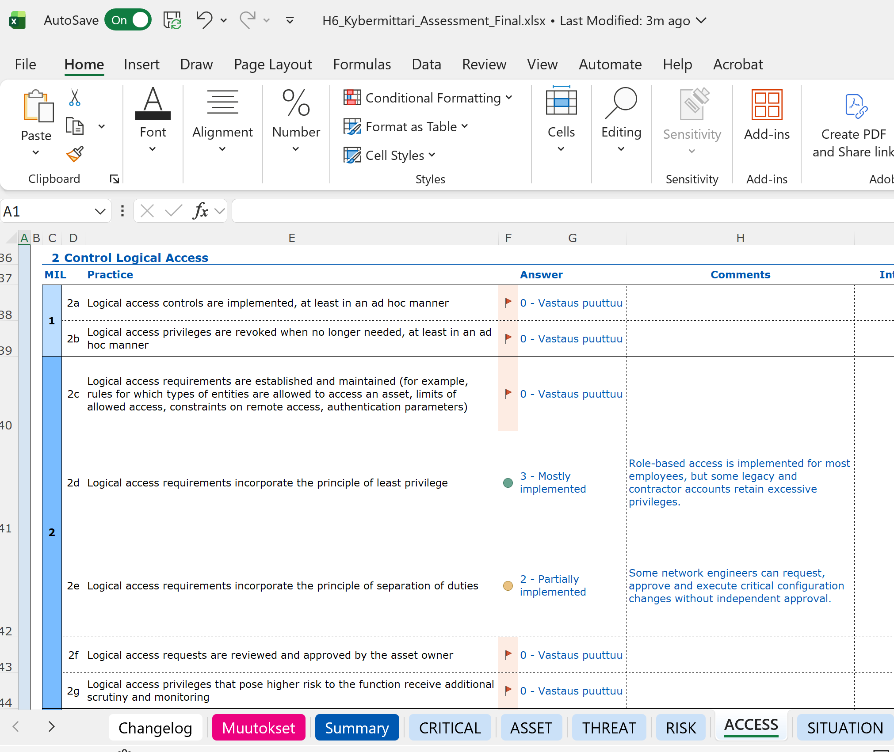

# h6 Mature – Cybersecurity maturity assessment

**Cyber Security (ICB705AS3YE-3002) | Haaga-Helia | 26 November 2026**

## x) Read and summarize

### Assessment process (Cybermeter User Guide, p. 10)

- **Initiate:** Management defines the assessment scope and appoints a sponsor and facilitator.
- **Prepare:** Identify critical systems, processes, data, dependencies and relevant participants; agree on the method and schedule.
- **Conduct:** Participants discuss practices and record their answers using the self-assessment tool.
- **Identify development activities:** Analyse gaps, set risk-based target levels and prioritise improvements.
- **Perform and update:** Implement the actions and reassess as the organisation or its risks change.

### Cybermeter maturity model (pp. 11–14)

- Cybermeter is a Finnish cybersecurity capability assessment framework developed by NCSC-FI (Traficom). It uses 11 domains, each containing objectives and practices.
- Maturity indicator levels (MILs) range from 0 to 3: basic requirements unmet (0), basic/ad hoc (1), documented and resourced (2), and advanced, policy-driven and continuously improved (3).
- Practices are rated from 1 (not implemented) to 4 (fully implemented). Ratings 3 and 4 count as implemented; an unanswered practice is not an assessment result.
- According to section 3.3 of the V1.0 guide, MIL 1 requires all level-1 practices; MIL 2 requires all level-1 and more than half of level-2 practices; MIL 3 requires all level-1 and level-2 and more than half of level-3 practices. A domain's maturity is based on its lowest objective. These rules prevent advanced practices from compensating for missing fundamentals.

### Cybermeter maturity report (p. 23)

- The report presents the maturity levels of all 11 domains and their individual objectives. It supports gap analysis and prioritisation of development activities.
- Previous results and reference data can be used to compare progress and support target-setting. A report is only as reliable as the underlying assessment.

### Spreadsheet overview

I used Kybermittari v2.1 (29 August 2023), an offline Excel workbook, and selected English on the Summary sheet. Summary contains the organisation, scope, risk scenario and assessment progress. The domain sheets contain practice ratings, comments, references and development areas. ACCESS has 35 practices in four objectives: Establish and Maintain Identities, Control Logical Access, Control Physical Access, and Management Activities. The workbook also provides reports and investment-related sections. No additional security software was needed. The guide is V1.0, while the practical exercise uses V2.1.

## a) Make-believe analysis

### Scenario and participants

Nordic Telecom Services is a fictional Finnish 5G operator. The assessment covers employee, contractor, service and device identities and access to network management systems. A credible worst-case scenario is a former contractor retaining an active account and disrupting local 5G services.

The fictional workshop includes Michael (Cybersecurity Manager and facilitator), Anna (Network Operations Manager), David (IT Infrastructure Engineer), Laura (HR Manager) and Peter (Finance Manager).

### Workshop dialogue

**ACCESS 1a – Establish and maintain identities (MIL 1)**

Michael: "Are identities created whenever personnel, services or devices require access?" Laura: "HR provides onboarding information to IT." David: "IT creates the required identities for personnel, services and network devices." Michael: "We agree that this practice is fully implemented." **Decision: 4 – Fully implemented.**

**ACCESS 1c – Remove identities when no longer required (MIL 1)**

Laura: "We notify IT when employees leave, but some contractor offboarding notifications are incomplete." Anna: "Former contractors may retain access to network management systems." Peter: "Let's prioritise fixing that process before buying more tools." **Decision: 2 – Partially implemented.**

**ACCESS 2d – Least privilege (MIL 2)**

David: "Most employees have role-based access, but some legacy and contractor accounts retain excessive permissions." Anna: "Engineers should only have the permissions needed for their work." Michael: "We should review access regularly and remove unnecessary permissions." **Decision: 3 – Mostly implemented.**

**ACCESS 2e – Separation of duties (MIL 2)**

Anna: "Some engineers can request, approve and execute critical configuration changes themselves." Peter: "Independent approval may require resources, but it reduces operational and financial risks." Michael: "Let's separate responsibilities for critical changes." **Decision: 2 – Partially implemented.**

### Assessment results and evidence

| Practice | Rating | Development priority |
| --- | --- | --- |
| 1a – Identity provisioning | 4 – Fully implemented | Maintain the existing process |
| 1c – Identity deprovisioning | 2 – Partially implemented | Link HR/vendor offboarding to IT and verify account removal |
| 2d – Least privilege | 3 – Mostly implemented | Review access and remove excessive permissions |
| 2e – Separation of duties | 2 – Partially implemented | Require independent approval for critical changes |

The Summary sheet displays **4/35** answered ACCESS practices. All other domains and unselected practices remain unanswered. This is assessment coverage, not an overall maturity score. The scenario, dialogue and ratings are fictional; the screenshots are from the actual Excel exercise.

*Figure 1. Summary – assessment scope result and progress (ACCESS: 4/35).*

*Figure 2. ACCESS – Establish and Maintain Identities: 1a and 1c.*

*Figure 3. ACCESS – Control Logical Access: 2d and 2e.*

## b) Sucks or succeeds

**When Kybermittari becomes useless:**

- Participants tick boxes without discussion or evidence, or inflate scores to satisfy management.
- Relevant stakeholders such as HR, finance and operations are excluded.
- Findings are not assigned to owners, funded or followed up. A favourable-looking report can create false confidence.

**When Kybermittari becomes useful:**

- Stakeholders discuss actual practices and support ratings with evidence.
- Weaknesses are prioritised according to business risks, with owners, resources and deadlines.
- Management follows up on corrective actions and repeats the assessment to measure progress.

In the fictional operator, account removal and independent approvals should be improved rather than assuming that good identity provisioning alone ensures security. The spreadsheet supports decisions; it does not secure the network by itself.

## c) Competition

### C2M2 v2.1 – Cybersecurity Capability Maturity Model

The U.S. Department of Energy's C2M2 contains over 350 practices across ten domains and supports IT and OT environments. It provides a structured maturity assessment and helps prioritise investments. Its detailed practices and stricter cumulative scoring can require more time and resources. It is not specifically adapted to Finland.

### NIST Cybersecurity Framework (CSF) 2.0

NIST CSF 2.0 organises cybersecurity risk management around six functions: Govern, Identify, Protect, Detect, Respond and Recover. It is internationally recognised, flexible and connects cybersecurity to governance and business risk. However, it does not prescribe Kybermittari-style practice-based MIL scoring; organisations may need additional tools or implementation guidance. Its four Tiers describe the rigour of risk governance and management, not the same maturity levels as Cybermeter.

Kybermittari is particularly suitable for a Finnish operator seeking a structured self-assessment. NIST CSF can complement it for broader risk governance, while C2M2 provides detailed capability guidance. The alternatives were compared conceptually, not tested.

## Conclusion

The exercise demonstrates that cybersecurity maturity depends on consistent practices and cooperation between technical and non-technical teams. Creating accounts correctly is not enough if unused accounts remain active or access privileges are excessive. Honest assessment and follow-up actions matter more than filling a spreadsheet.

## References

- Traficom / NCSC-FI. [Cybermeter User Guide, V1.0](https://terokarvinen.com/kybermittari/files/Kybermittari_Cybermeter_User_Guide_V1.pdf), pp. 10–14, 23.
- Traficom / NCSC-FI. [Kybermittari self-assessment tool v2.1](https://terokarvinen.com/kybermittari/files/Kybermittarin%20arviointity%C3%B6kalu_v2.1_20230829.xlsx), 29 August 2023.
- Tero Karvinen. [Kybermittari – Traficom security maturity spreadsheet](https://terokarvinen.com/kybermittari/).
- U.S. Department of Energy. [Cybersecurity Capability Maturity Model (C2M2)](https://www.energy.gov/ceser/cybersecurity-capability-maturity-model-c2m2).
- NIST (2024). [The NIST Cybersecurity Framework (CSF) 2.0](https://doi.org/10.6028/NIST.CSWP.29).
